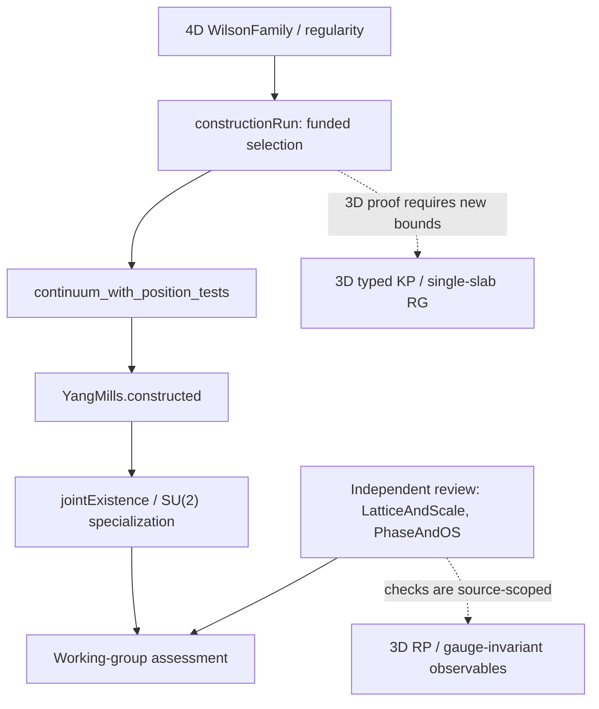

# Mathematical crosswalk: 4D Lean construction to the 3D ledger

## 1. Source and epistemic status

The [original October source](https://github.com/yang-mills-group/OpenAI-YM-20261028/tree/3456e5e75cf8d4cd558955a5c7638fba2d68f464) advertises a 4D Wilson construction, Wightman reconstruction, OPE and non-freeness test. The [working-group review](https://github.com/yang-mills-group/YM/tree/55ba9fc36293b3f4d52c6b1f813169a0be76ee98) records additional independent acceptance checks. Its conclusion is an *assessment* of the mathematical and physical interpretation, not a proof of a positive mass gap.

This first tranche is a **source audit**, not a reproduction of the upstream Lean/Comparator build. It does not import an upstream theorem into the 3D proof DAG. Source-level provenance, formal proof validity, physical adequacy of definitions, and transfer to 3D are separate obligations.

## 2. The critical dimensional mismatch

In `PublicTheory.lean`, `Axis := Fin 4`. `PublicWilson.lean` defines periodic link configurations, plaquettes and a normalized Wilson measure over these axes. `ChallengeSpec.lean` imposes a logarithmic running condition on `C.beta N p / log(1/C.mesh N)`. This is consistent with a four-dimensional asymptotically-free scaling narrative.

Our 3D Wilson convention instead has a dimensionful coupling, `[g3^2] = mass`, and bare `beta(a) = 4/(g3^2 a)` for SU(2). Consequently:
- the 4D logarithmic regularity condition does **not** certify our slab flow;
- none of the abstract `RG.Levels`, `Funded` or `R2I` fields may be read as a 3D contraction without a fresh estimate;
- even a fully checked 4D continuum existence theorem does not establish a 3D physical mass gap.

**Transfer test:** instantiate an actual 3D Wilson law; prove the finite link/plaquette identities, a measured error in one declared norm, and one typed polymer bound over a specified beta slab. Until then, record `candidate_only`.

## 3. Dependency spine and points of scrutiny

The construction entry `YM/Independent/ConstructionRun.lean` builds its existence witness from `R2I.RG05Joint.selectRunWithTreasuryPeriod_preselected_quote_orders_postnumeric`, with `RiderResourceDynamics.defaultDynamics` and `ActualRunNativeComponentRecipe` supplying inputs. The latter packages resource floors and payment conditions; each such receipt is *a formal condition*, not automatically a physical 3D inequality. The next audit must trace quantitative definitions to actual Wilson-integral bounds before treating them as transferable.

The upstream `YM/R2I/Campaign/Accepted.lean` defines a `Funded` structure with polymer/log/halo obligations. Those names suggest useful comparison points with our terminal and nonterminal KP activity vectors, but do not prove their norms or smallness in three dimensions.

## 4. What is worth reusing immediately

**Verification architecture.** `VerifyJoint.lean` audits declared theorem types, reachable dependencies, axiom classes, and replays project declarations in a kernel environment with external dependencies only. The external working-group runner pins source hashes and toolchains, and separates compilation, acceptance and OPE checks. A comparable methodology could harden our future Lean finite-group audit.

**Source-to-claim contracts.** Working-group `LatticeAndScale` requires the Wilson probability law, moments, calibration, and volume extraction to hold for one construction witness. We should adopt that *same-witness pattern* for the 3D scale-slabs and observable registry.

**Scoped OS evidence.** The independent review's selected scalar OS checks are useful for designing precise interfaces. They are not evidence that our proposed gauge-average transfer preserves OS positivity; the 3D reflection-factorization gate remains open.

## 5. First transfer candidates, with stop conditions

| Candidate | Required 3D deliverable | Stop condition |
|---|---|---|
| Wilson/Haar finite-lattice interface | Fully defined 3D `SU(2)` measure and equality checks for plaquette words | Different action or gauge convention without explicit conversion |
| Campaign / polymer budget | Source theorem list with actual norms and a new scale-indexed 3D bound | Only abstract expense/funding predicates, no Wilson-measure inequality |
| RG step scheduling | A single dyadic `L=2` step with beta-norm-typed error vector | 4D log beta substituted for 3D dimensional beta |
| Reflection reconstruction | RP-compatible 3D observable family, plane-factorization certificate | Selected scalar OS interpreted as full gauge sector |
| Kernel replay | A prototype Lean 4 proof of `O_h` action closure and orbit–stabilizer | Existing imported proof artifacts not independently sourced |

## 6. Claim boundaries

This work has not run the upstream Lean toolchain, audited all upstream definitions, proved a dimensional transfer, or closed a new `program.yaml` gate. The mass-gap target remains open. Any future declaration of transfer must include a **new local theorem** with hypotheses expressed in 3D primitives, a verified certificate, and an explicit claim-strength transition.
